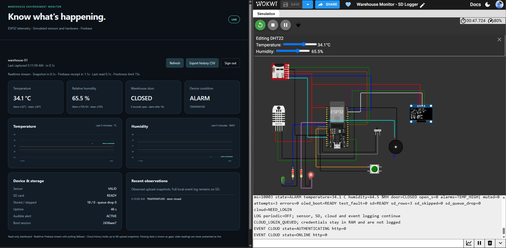
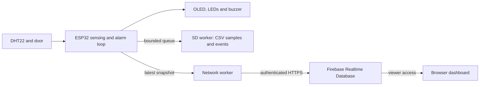
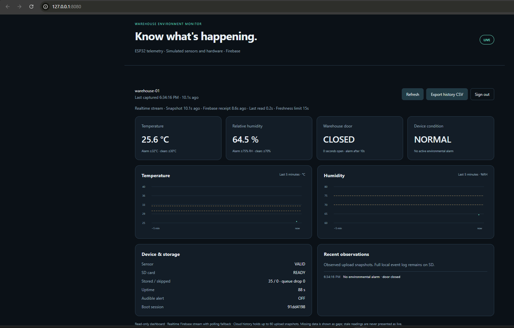
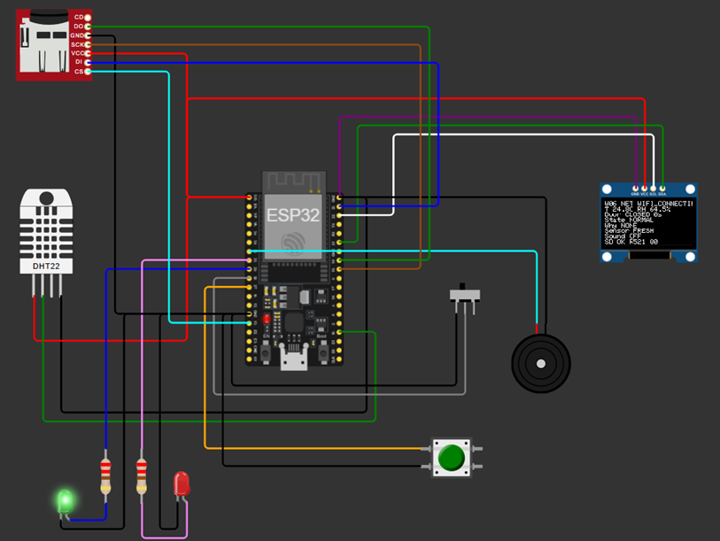
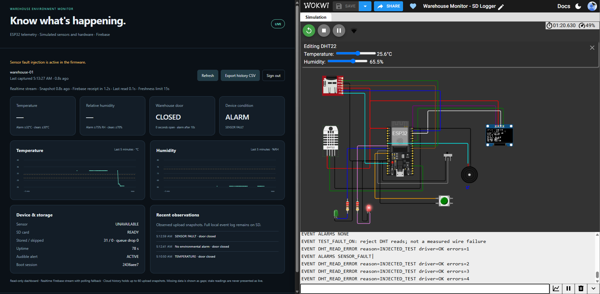

# Warehouse Environment Monitor

[](https://github.com/MinhNhan0508/Esp32-warehouse-monitor/actions/workflows/ci.yml)

An ESP32 system that monitors warehouse temperature, relative humidity and door
state, raises local alarms, logs samples and events to microSD, and publishes
telemetry to Firebase for a read-only web dashboard.

The circuit runs in **Wokwi** with simulated sensors and peripherals. Firebase
receives telemetry from the firmware; the local web server only serves the dashboard.



**[Watch the demo](docs/assets/warehouse/warehouse-demo-web.mp4)**. The recorded Wokwi/Firebase session shows environmental
alarms, door monitoring, ACK, fault recovery, SD events and CSV export.

## Features

- DHT22 samples every 2.5 seconds, with invalid-reading and stale-sensor detection.
- Temperature alarm at 32°C, cleared at 30°C; humidity alarm at 75%, cleared at 70%.
- Debounced door input and an alarm after 10 seconds continuously open.
- OLED, status LEDs and buzzer; ACK mutes acknowledged alarms for 60 seconds.
- Separate FreeRTOS workers for microSD logging and authenticated HTTPS uploads.
- Separate Firebase device-writer and dashboard-viewer roles enforced by Rules.
- Live values, alarm causes, storage status, charts and CSV export. Stale or invalid
  sensor values are hidden instead of being presented as current measurements.

## Architecture



Alarm decisions remain local. A latest-snapshot mailbox prevents a slow network
from accumulating an upload backlog; SD has its own bounded queue and loss counters.
Uptime drives alarm timing, while synchronized UTC supports cloud freshness checks.
See [architecture](docs/architecture.md) and [data schema](docs/data-schema.md).

## Run it

Start with the [setup guide](docs/setup.md) for the pinned Arduino dependencies,
Firebase accounts and configuration. The published configuration is blank,
cloud uploads are disabled, and the supplied database Rules deny all access.

After configuring your own Firebase project and installing the build dependencies:

```sh
python tools/warehouse_firmware.py
python tools/wokwi.py bundle
python tools/warehouse_cloud.py open
```

Load `.build/wokwi-upload/warehouse-monitor.merged.bin` through Wokwi's
**Upload Firmware and Start Simulation** command and use the supplied
[circuit diagram](targets/esp32-wokwi/warehouse-local/diagram.json).
Match the Serial BUILD ID to `.build/wokwi-upload/manifest.json`.
Enter the device credentials in Serial and the viewer credentials on the dashboard.

On Windows, `OPEN_DASHBOARD.cmd` starts or reuses the local dashboard server.
VS Code tasks are available through `Warehouse-Monitor.code-workspace` after
creating the development `.venv`. Passwords are supplied at runtime.

## Tests and results

The [Build & Tests workflow](https://github.com/MinhNhan0508/Esp32-warehouse-monitor/actions/workflows/ci.yml)
runs native C logic/logger/cloud-policy tests, Python configuration and packaging
checks, dashboard browser tests, Firebase Auth/Database Emulator tests, and ESP32
builds with cloud disabled and enabled using dummy identifiers.

Browser tests mock Firebase traffic; emulator tests use fake local users.
The recorded demo provides separate Wokwi/Firebase runtime evidence. See
[testing and results](docs/testing.md) for commands, scope and manual checks.

## Screenshots

<details>
<summary>Normal readings and storage ready</summary>



</details>

<details>
<summary>Wokwi circuit</summary>



The capture was taken while Wi-Fi was connecting.

</details>

<details>
<summary>Injected sensor fault</summary>



LIVE indicates fresh device status, even when a sensor is unavailable.

</details>

## Source layout

| Path | Purpose |
| --- | --- |
| `targets/esp32-wokwi/warehouse-local/` | Final firmware, Wokwi diagram and pinned Arduino libraries |
| `web/warehouse/` | Browser dashboard and blank configuration |
| `tools/` | Configuration/server, firmware build, source package and compile profile |
| `firebase/` | Default-deny database Rules |
| `tests/` | Warehouse C, Python, browser and local emulator tests |
| `docs/` | Setup, architecture, wiring, schema, testing and troubleshooting |

## Limits

Thresholds are illustrative. The project has not been calibrated or tested on
physical hardware. Cloud history retains 60 snapshots and charts cover up to
five minutes; it is not a complete acquisition archive. Slow or paused simulation
can interrupt delivery. Wokwi SD behavior does not establish power-loss durability.
The demo contains delivery gaps and does not establish continuous availability.

## Contribution and license

I assembled and wired the Wokwi circuit, configured Firebase Authentication and
Database Rules, ran the manual test scenarios, checked device/dashboard behavior,
and recorded the demo. The implementation and documentation were developed with
AI assistance.

Original project source is licensed under [GPL-3.0-only](LICENSE). Third-party
components retain their own licenses; see [licensing](LICENSING.md) and
[third-party notices](THIRD_PARTY_NOTICES.md).
