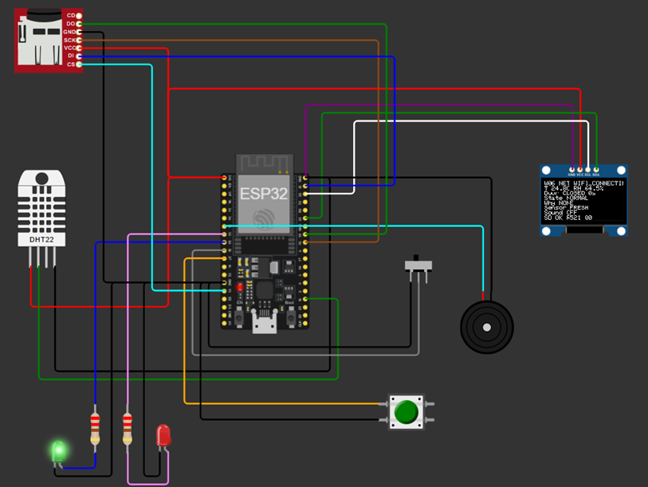

# Wiring and pinout

The source of truth for the simulated circuit is
[`diagram.json`](../targets/esp32-wokwi/warehouse-local/diagram.json).
The wiring test checks connections against firmware constants, power/ground nets,
OLED address, pull-ups and LED series resistors.

| Peripheral / signal | ESP32 pin | Notes |
| --- | --- | --- |
| DHT22 data | GPIO 15 | Simulated temperature and RH |
| OLED SDA | GPIO 21 | I2C, address `0x3c` |
| OLED SCL | GPIO 22 | 128 × 64 SSD1306 |
| Door switch | GPIO 26 | `INPUT_PULLUP`; switch to GND, open reads HIGH |
| ACK button | GPIO 27 | `INPUT_PULLUP`; press connects to GND |
| Green LED | GPIO 25 | 220 Ω series resistor, cathode to GND |
| Red LED | GPIO 33 | 220 Ω series resistor, cathode to GND |
| Buzzer signal | GPIO 32 | Other terminal to GND |
| microSD CS | GPIO 13 | SPI chip select |
| microSD SCK | GPIO 18 | SPI clock |
| microSD DO / MISO | GPIO 19 | Card output to ESP32 |
| microSD DI / MOSI | GPIO 23 | ESP32 output to card |

DHT22, OLED and microSD connect to the simulated 3V3 and common GND nets.
The door switch's unused throw, SD card-detect signal and DHT22 NC pin remain
unconnected. Retain the ESP32 `cpuFrequency: max` simulator setting.

This diagram describes a Wokwi simulation. It is not a verified physical wiring
or electrical design for a particular ESP32 board, sensor module or SD adapter.
